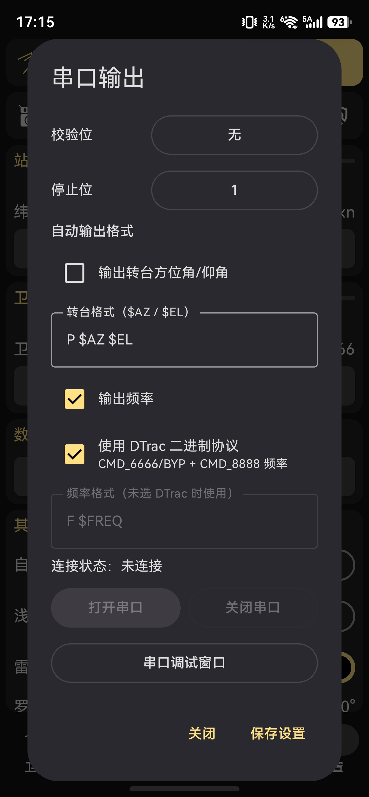
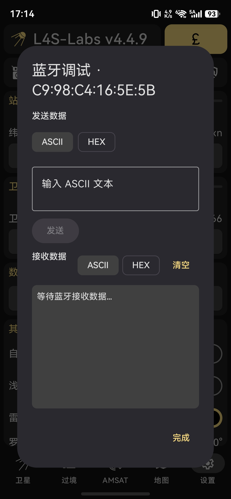
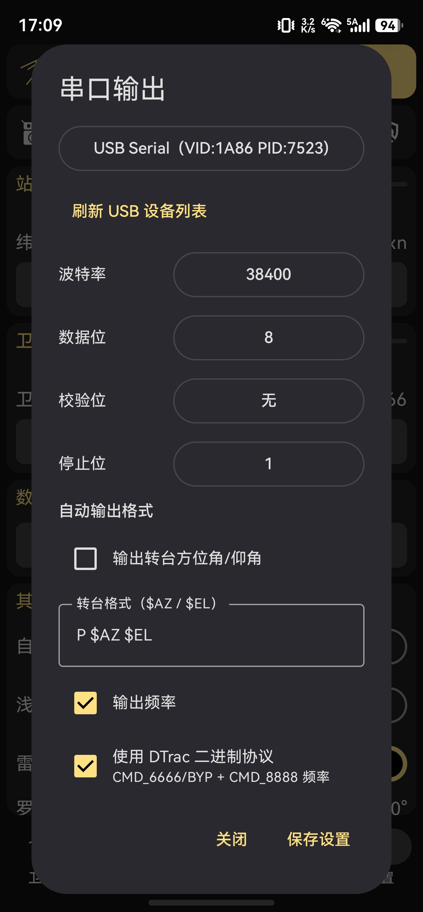
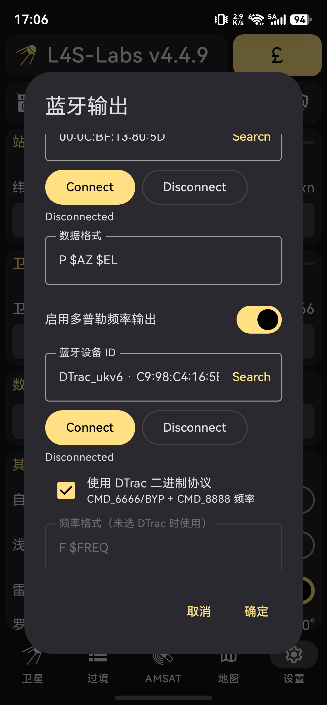
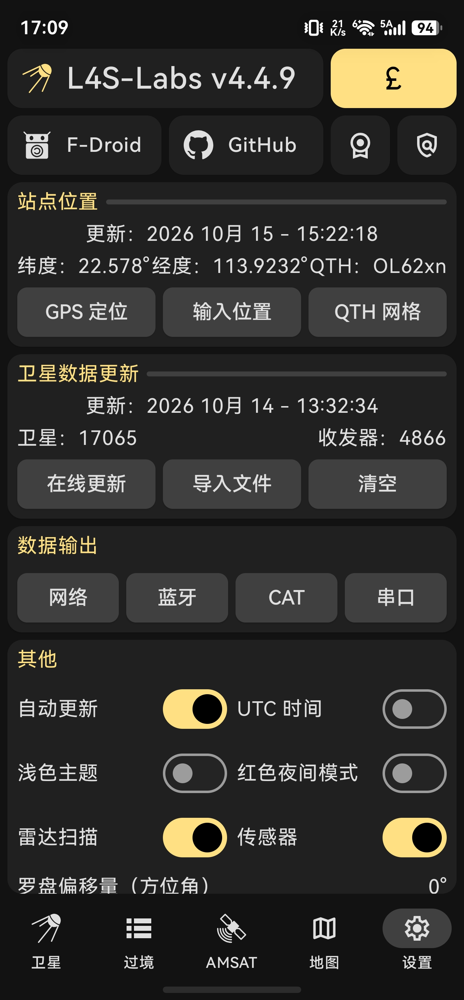

# L4S-Labs

基于 [Look4Sat](https://github.com/rt-bishop/Look4Sat) v4.4.9 的个人定制版本，面向卫星跟踪、无线电控制与 SSTV 接收使用。

> **说明：** L4S-Labs 是独立的定制项目，不是 Look4Sat 官方发布版本，也不代表原作者。上游项目的版权声明及许可证请参阅本仓库中的 `LICENSE` 文件。上游原始项目：[rt-bishop/Look4Sat](https://github.com/rt-bishop/Look4Sat)。

## 定制功能

### 蓝牙输出（BLE GATT / Bluetooth SPP）

- 支持 BLE GATT 和经典蓝牙 SPP 双模串口模块。
- 蓝牙设置中可搜索和选择设备，并显示设备名称及 MAC 地址。
- 提供连接状态、连接/断开操作和蓝牙调试窗口。
- 调试窗口支持 ASCII / HEX 发送、ASCII / HEX 接收显示和清空接收内容。
- BLE GATT 当前按 UUID 前缀识别服务与特征值：
  - Service：`0000fff0` 开头
  - Notify：`0000fff1` 开头
  - Write：`0000fff2` 开头
- 经典蓝牙 SPP 使用标准 RFCOMM/SPP 连接方式。

### USB 串口输出

- 支持通过 Android USB Host / OTG 连接兼容的 USB-UART 模块。
- 可配置波特率、数据位、校验位和停止位，并提供打开/关闭控制。
- 串口调试窗口支持 ASCII / HEX 手动发送、接收显示和清空接收内容。

### 频率及转台数据输出

- 可设置频率、方位角和仰角输出格式。
- 默认文本格式：频率 `F $FREQ`；方位角/仰角 `P $AZ $EL`。
- 可选择启用 DTrac 二进制协议输出。该功能属于定制功能，实际兼容性应以所使用的 DTrac 固件和抓包结果为准。

### SSTV 接收

- 支持 SSTV 实时逐行预览。
- 可在解码过程中保存当前显示的图像。
- 解码开始时录制音频；暂停时可单独保存 WAV 录音。
- 音频保存目录为 `Recordings/L4SLABS`（具体可见设备上的媒体/文件管理器）。

## 构建

### 环境

- Android Studio 或 Android SDK
- JDK 21（以项目 Gradle/Android Gradle Plugin 配置为准）
- 已安装 Android SDK Build Tools

### 编译 Release

在 Linux / Ubuntu 项目根目录执行：

```bash
./gradlew clean assembleRelease
```

默认构建产物通常位于：

```text
app/build/outputs/apk/release/app-release-unsigned.apk
```

如果构建配置未自动签名，需要使用自己的签名密钥对 APK 进行 zipalign 和签名后再安装。请将签名密钥（例如 `.jks` / `.keystore`）、密码及本机 `local.properties` 保存在本地，**不要提交到 GitHub**。

## 安装与使用提示

- BLE 设备必须提供与配置相匹配的 GATT 服务及特征值；仅名称或 MAC 地址相同并不能保证 GATT UUID 兼容。
- USB 串口需要手机支持 USB Host / OTG，并使用兼容的 USB-UART 芯片/驱动。
- DTrac 二进制协议属于定制功能。连接真实设备前，建议先通过蓝牙/串口调试窗口检查实际发送帧，并确认电台端协议设置。
- 无线电发射、频率控制和卫星跟踪前，请确认本地法规、设备能力及无线电参数设置。

## 上游项目与许可证

本项目基于 [rt-bishop/Look4Sat](https://github.com/rt-bishop/Look4Sat) 的源码进行修改。感谢上游作者及贡献者。请保留仓库中的 `LICENSE` 和原始版权声明；本项目的许可证义务以该文件及上游许可证条款为准。

## 应用界面展示










